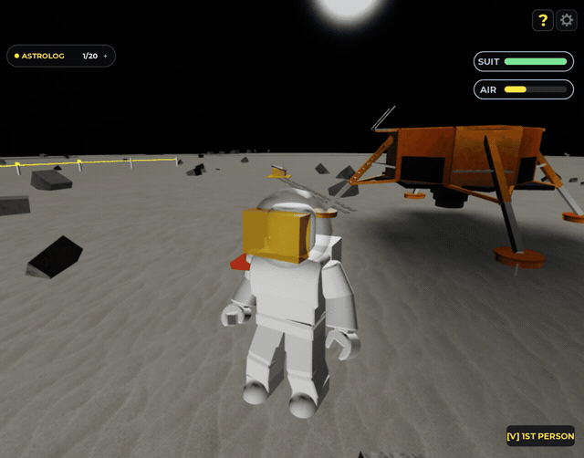
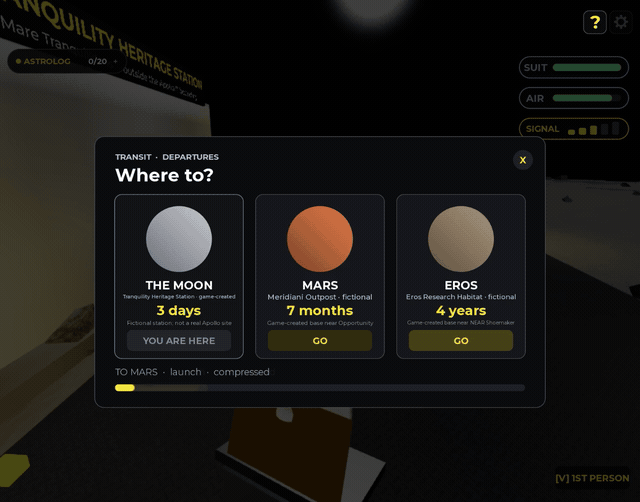
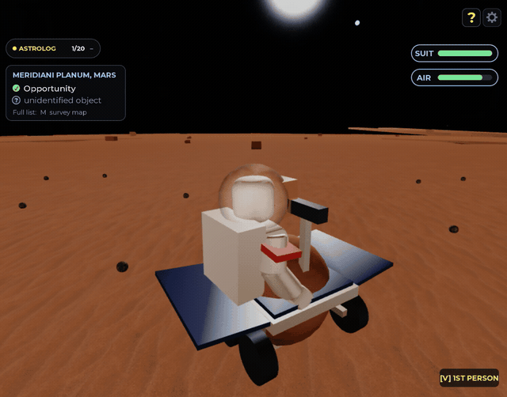

# Last Signal

**A public interactive field guide to the spacecraft and instruments humanity left behind.**

Made by **Astrolog** for NASA Space Apps Challenge 2026, challenge [Abandoned but not Forgotten: Storytelling about NASA's Discarded Equipment on the Moon and Mars](https://www.spaceappschallenge.org/2026/challenges/nasas-discarded-equipment-storytelling/?tab=details).

Last Signal is a website-first educational project for NASA Space Apps Challenge 2026. Anyone can open the project site, read the mission stories and sources, watch the demonstration, and launch the playable expedition in the browser without a password, account, or registration. Visitors explore the Moon, Mars, and 433 Eros, find historical spacecraft and instruments, scan them, and learn what they were designed to do and what their missions taught us.

## Public project website

**The submitted project is the public website:** [Last Signal — open project](https://dankwa-wadie.github.io/last-signal-space-apps-2026/). Its main page presents the challenge, complete field-object catalog, a playable embedded expedition, live gameplay evidence, source links, and disclosures. The expedition includes 13 destinations, 20 field artifact scans, six reactivation challenges, an 18-record NSSDCA archive, transit timelines, life-support refills, shelters and timed hazards, a survey map, a saved field log, and the final marker handover. Browser progress is saved locally on the player’s device.

The [interactive expedition](https://dankwa-wadie.github.io/last-signal-space-apps-2026/field.html) also has a direct URL. It uses WebGL and procedural models; the project’s core story and sources remain available on the main page.

The Pages site is built from [`index.html`](index.html) and published by [`.github/workflows/pages.yml`](.github/workflows/pages.yml). The 3D expedition is built from [`test.html`](test.html) and published at `field.html`.

## Live gameplay videos

### Combined demo · 26 seconds

https://github.com/user-attachments/assets/5a5b403f-88c3-4c91-a7e8-494c66ca8a1d

If the player above does not load, open the clip directly: [`competition-demo-live-gameplay.mp4`](https://github.com/Dankwa-Wadie/last-signal-space-apps-2026/blob/main/game/videos/competition-demo-live-gameplay.mp4)

### Moon · Apollo 11 artifact scan

https://github.com/user-attachments/assets/647b436b-9217-49f9-8a40-588c612a1db0

If the player above does not load, open the clip directly: [`moon-live-gameplay.mp4`](https://github.com/Dankwa-Wadie/last-signal-space-apps-2026/blob/main/game/videos/moon-live-gameplay.mp4)

### Mars · transit and Opportunity

https://github.com/user-attachments/assets/e0249a10-30ce-4fd0-b899-73c474396500

If the player above does not load, open the clip directly: [`mars-live-gameplay.mp4`](https://github.com/Dankwa-Wadie/last-signal-space-apps-2026/blob/main/game/videos/mars-live-gameplay.mp4)

These are direct recordings from Roblox Studio's live Play session. The same MP4 files are committed to [`game/videos/`](game/videos), so they remain available even if an embedded player fails. A [dedicated demo page](https://github.com/Dankwa-Wadie/last-signal-space-apps-2026/issues/1) collects all three clips in one place.

## Scene previews

| Moon · Apollo 11 site | Transit · Moon to Mars | Mars · Opportunity |
|:---:|:---:|:---:|
|  |  |  |

## Project contents

- `game/scripts/` — exported Roblox scripts (recovery copy)
- `game/build/` — Luau builders and patches used during development
- `game/archive_catalog.json` — artifact facts, attribution references, and identifiers
- `game/manifest.json` — exported world/model manifest
- `game/tests/` — existing checks
- `game/videos/` — live gameplay evidence
- `pipeline/` — source scripts, scene descriptions, and configuration for the separate cinematic render workflow
- `SUBMISSION.md` — paste-ready project-page draft and disclosure notes
- `REFERENCES.md` — source and material attribution register
- `AI_DISCLOSURE.md` — tools used in creating the project

## Development build and project files

The team prototyped the experience in Roblox Studio. The public website is the final project and does not require Roblox; the Studio recordings are supplementary evidence from development. The repository contains exported scripts and a world-manifest recovery backup, but not a complete `.rbxl` place file. Some development models are referenced by Roblox asset IDs and are not required to use the public web project.

## Rebuilding and development

See [`game/README.md`](game/README.md) for the Roblox export/recovery notes and [`pipeline/README.md`](pipeline/README.md) for the film pipeline. Roblox Studio and the project’s Studio MCP integration are needed to apply or run the exported scripts. Render caches, intermediate frames, and prior cinematic exports are excluded; the live gameplay MP4 files are retained.

## Accuracy and fiction

Historical mission and artifact details are intended to follow the cited NASA/NSSDC sources. Distances, time compression, playable layouts, and future heritage bases are simplified for gameplay. In-game labels identify fictional stations and other additions so they are not mistaken for real mission hardware.

## License

Original code in this repository is licensed under the MIT License; see [`LICENSE`](LICENSE). Original project text and graphics are licensed under CC BY 4.0; see [`LICENSE-MEDIA.md`](LICENSE-MEDIA.md). Third-party Roblox assets, NASA material, and other credited material remain under their own terms; consult [`REFERENCES.md`](REFERENCES.md) before reuse. This repository license does not relicense third-party material.
